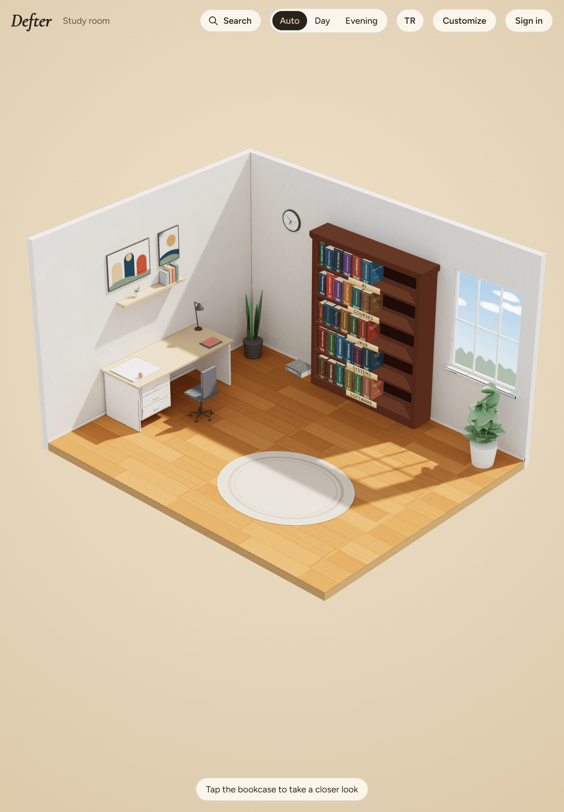
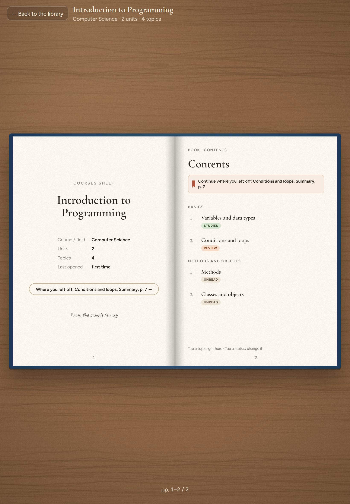
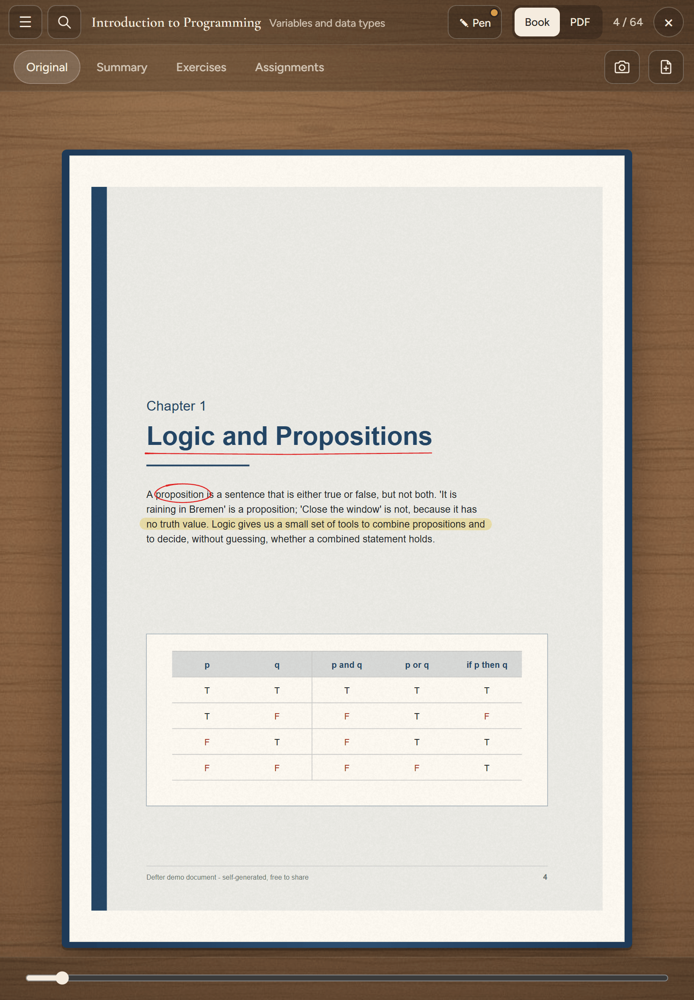
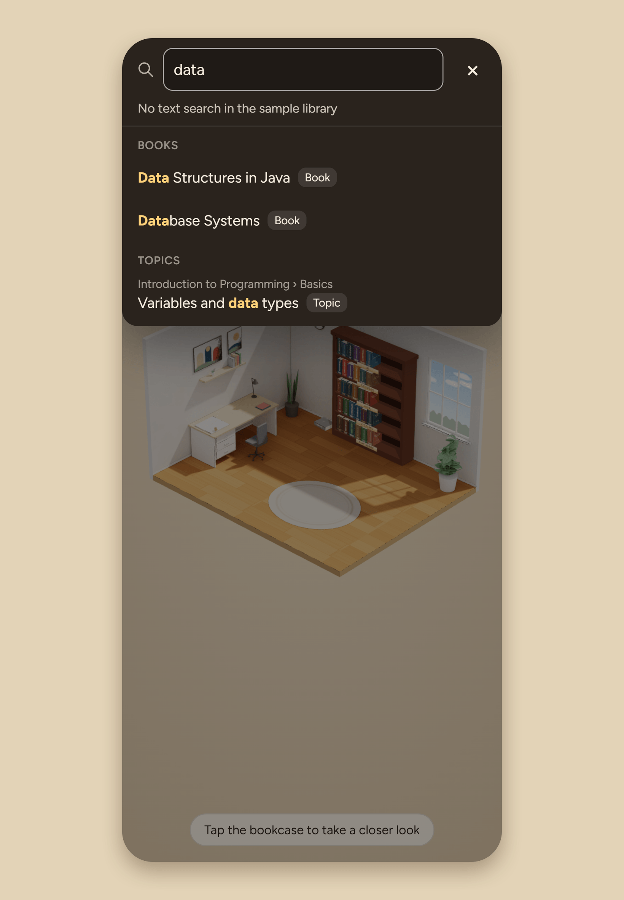
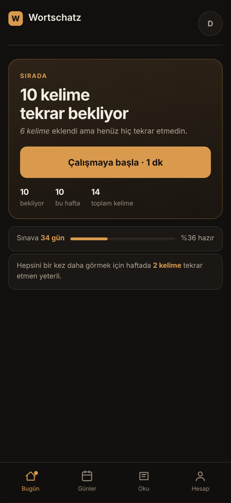
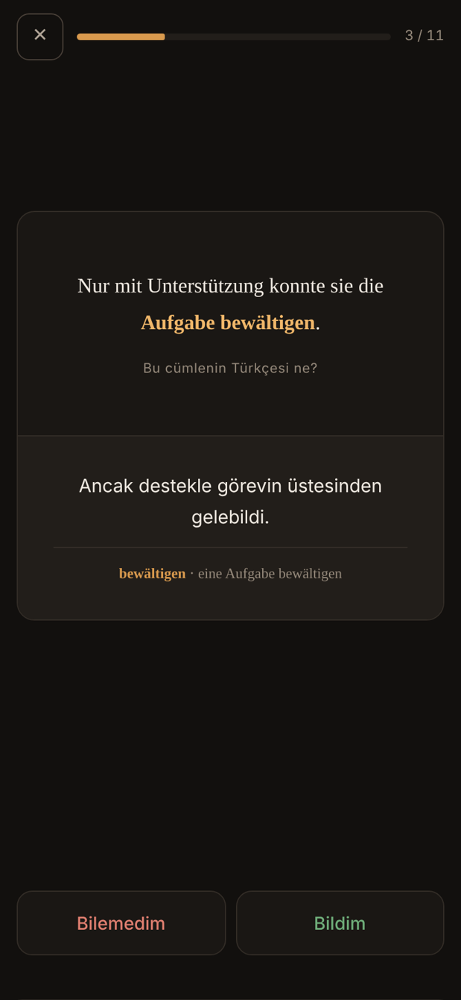
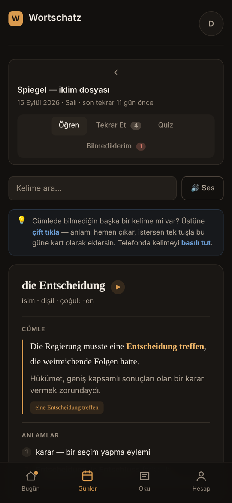
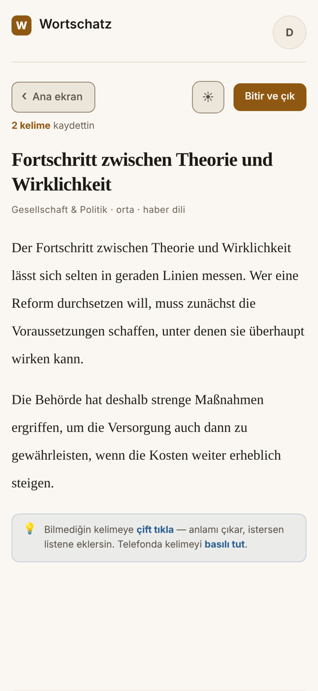

# Deniz Yarpınar

Informatics student in Germany. I build the tools I need for myself, then make them good enough for
other people to use. Two of them are below: one keeps my semester in order, the other teaches me German.

---

## Defter — my study notes as books in a 3D study room

**Live** · [defter-jade.vercel.app](https://defter-jade.vercel.app) · sign in with Google · [source](https://github.com/denizyarpinar/defter)

  
  
  
  

Every course becomes a book on a shelf in a small 3D room. Lecture PDFs, photos of my
paper notes, exercise sheets and solutions sit inside it as tabs, and I can write on any
page with a pen on the iPad. All files stay in my own Google Drive. Defter only reads them,
arranges them, and writes back the notes I add.

I built it because my semester was scattered across folders, photos and chat exports, and
the note I needed was never where I looked. A shelf you can see is easier to keep in order
than a folder tree.

**What's interesting about it**

- **No database. Your Drive is the backend.** The app is a catalogue and a reader on top of
  the user's own files. The only server code is a single function for handwriting
  recognition, and access tokens live in memory, never in `localStorage`.
- **Pen notes are real PDF annotations.** Strokes are saved as standard Ink annotations
  inside the PDF, so they open in any PDF reader. Every stroke goes to IndexedDB first and
  then to Drive, and no error ever discards a pending save.
- **Handwriting recognition was measured, not assumed.** On my own notes, Tesseract read
  0–2 of 20 words and Google Drive OCR 10–17. Claude Haiku read 17–20, so it became the
  engine. Results go into a side file next to the PDF, which makes handwriting searchable.
- **A "clean" view in my own handwriting.** Instead of a computer font, messy pages are
  re-set using real letter images cut from my own ink on squared paper. The original stays
  one tap away.
- **It never deletes anything from your Drive.** It only moves things to the trash, always
  with Undo, and it asks for the narrow `drive.file` permission. New code that writes to
  Drive first ships behind a URL switch and is unlocked only after real tests.
- **Two languages without a library.** English and Turkish strings are typed, so a missing
  translation fails the build. A script checks 160 screens for overflowing text.

<b>More decisions</b>

 

**The room is pre-lit, not lit live.** Lighting is baked in Blender as day and evening maps
that switch with the device clock. On the iPad the budget is fixed: pixel ratio ≤ 2, shadow
map ≤ 2048, and no rendering when nothing moves.

**Search understands how students type.** One box searches book names, Drive full text and
recognised handwriting. `ı` folds to `i`, and `ä` also matches `ae`, so a German word
typed on a Turkish keyboard still finds the page.

**How I build it with AI tools.** Claude plans each step and writes a task file (goal,
what not to touch, definition of done, verification), Codex implements it, and the tool
that didn't write the code reviews it. Rules, 29 numbered architecture decisions and a
40-line current state live in the repo, so every tool starts from the same context.
Nothing reaches `main` without my approval. The suite has 1,800+ tests.

**Stack:** TypeScript · Vite · three.js · PDF.js · Google Drive API · Vercel · Anthropic Messages API

---

## Wortschatz — German vocabulary trainer for Turkish speakers

**Live, invite-only beta** · [meinwortschatz.app](https://meinwortschatz.app) · source private, happy to walk through it on request

  
  
  
  

You paste the words you picked up while reading. For each one, the app writes a C1-level
example sentence, its Turkish translation, the typical collocation and two usage notes.
Then you study them with flashcards and quizzes, and meet them again in short reading texts
written around your own words, where any word can be tapped for a translation.

I built it while learning German myself: isolated words don't stick, but a B1 learner
can't yet write the sentence that would make them stick. The app writes the content of
the card, which is the part everyone skips.

**What's interesting about it**

- **Each card is generated once, for everyone.** Cards belong to a shared dictionary, not
  to the user who asked for them. The second person who adds `die Entscheidung` gets it
  instantly, for free, without using quota, so cost per user falls as the user base grows.
  A 478-word B2 core pack was generated once, and every new account gets it for free.
- **A German stem matcher makes the sharing work.** `Entscheidungen` has to find
  `die Entscheidung`: inflectional endings are stripped, umlauts folded, `ß↔ss` normalised
  and doubled consonants reduced. Derivational suffixes like `-ung` are deliberately left
  alone, because they change the meaning rather than the form.
- **Built to survive bad model output.** Generation runs in four passes with shrinking
  batches and growing backoff, every batch is saved the moment it arrives, and words that
  fail wait as "pending" until one tap finishes them. Broken JSON is repaired instead of
  thrown away. Permanent errors (credit, quota) stop the chain at once.
- **The right model for each job.** C1 reading texts go to a large model, B1/B2 texts and
  word lookups to a small, cheap one.
- **Zero dependencies, no build step.** One HTML file, eight serverless endpoints on
  Node's standard library, and deployment is `git push`.
- **The browser never touches the database.** Row-level security on every table with no
  policies, `scrypt` password hashes, HMAC-signed `HttpOnly` session cookies, and
  single-use invite codes claimed in one atomic update.

<b>More decisions</b>

 

**Design was measured, not argued.** I reviewed my own product against WCAG 2.2 and found
two colour tokens below threshold, including the one used for every helper text in the
app (3.24:1). Navigation moved to a bottom bar after measuring that 28% of the review
screen went to chrome instead of content.

**Honest numbers, no gamification.** No streaks, badges or points. The exam-readiness
figure is computed per word and decays over time, so it can't tell someone who just
missed three words that they are 100% ready.

**The beta is judged by two numbers.** How many new users finish their first review on
the day they sign up, and how many come back within 48 hours. Both are recorded once on
the server and shown only for accounts created after measurement went live, so old data
can't flatter them.

**How I build with AI tools.** Claude plans and writes a task spec for each change
(goal, requirements, what not to touch, definition of done), Codex implements it, and the
tool that did not write the code reviews it. Every database, auth or API change ships
with a rollback SQL file. Tests call the real handlers against an in-memory fake
PostgREST, with the model API mocked.

**Stack:** Vanilla JS · Node.js serverless on Vercel · Supabase (Postgres) over PostgREST ·
Anthropic Messages API · Resend

---

**Reach me:** yarpinardeniz@gmail.com
